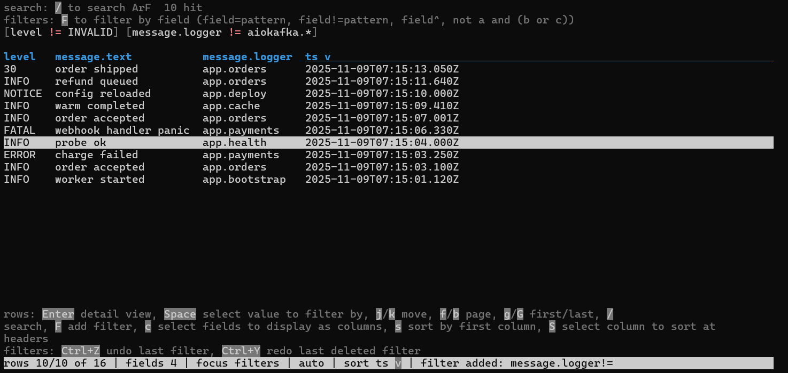

# silv - simple interactive log viewer

[](https://github.com/chamoretto/silv/actions/workflows/ci.yml)
[](https://github.com/chamoretto/silv/releases)
[](LICENSE)
[](https://www.rust-lang.org)

## Preview



## Little disclaimer

SILV is an experimental software, written by LLM-agent and me, written for me for my needs, for training in LLM-assisted
coding and learning Github systems (releases, etc.).
I am not responsible for its use, reuse, or forks. Use it on your own risk.
All used dependencies rights belong to their respective owners.
This software provided as is. I don’t promise to fix anything or respond to issues.

## Description

SILV reads JSON Lines and `timestamp | LEVEL | message key=value` logs and shows them in a
Kibana-like layout. Two modes share the same visuals:

- **Interactive TUI** (default when stdin and stdout are terminals): sticky search bar, filter
  chips, sticky field header, scrollable rows table, full-screen record detail with field actions.
- **Stream mode** (default when piped): grep-like colored output, fields table on top, driven by
  CLI flags. Exit code `1` when nothing matched, like `grep`.

Single statically linked binary, drop it on a server over SFTP and run it.

## Build

```sh
cargo build --release            # target/release/silv
scripts/build-release.ps1        # windows release (dist/)
scripts/build-release.sh         # unix releases (dist/)
```

Prebuilt binaries for windows, linux (musl) and apple silicon are attached to each
[release](https://github.com/chamoretto/silv/releases) (with `SHA256SUMS`).

Requires Rust stable (edition 2024). All dependencies are pure Rust with exact `=x.y.z` pins, so
fully static builds work on windows (MSVC CRT static) and linux (musl).

## Quick start

```sh
silv app.jsonl                                   # interactive, whole file
silv -p app.jsonl -f @timestamp,@level,message --fields-non-ordered-last
silv -p app.jsonl --filter-neq message.logger "aiokafka.*" --search timeout
cat app.jsonl | silv -p --filter-eq level WARN --render kv
silv -p app.jsonl --filter 'level=WARN and not message.logger=app.payments'
silv -i logs/ --include '*.jsonl' -r --max-records 100000
```

## Input

- Files and directories as positional arguments; a lone `-` (or no arguments) reads stdin.
- Directories are scanned non-recursively unless `-r`; `--include`/`--exclude` globs match the
  path and the file name.
- Format auto-detection per source: a first JSON object line means JSON Lines, a
  `timestamp | LEVEL | message` shape means the plain stdout format. Force with
  `--format jsonl|plain`.
- Large files (>= 8 MiB) are memory mapped; parsing is parallel per line. All records are kept in
  RAM (the price of the Kibana experience), capped by `--max-records` (default 500 000).
- Lines that fail to parse become `INVALID` records and stay visible; `--no-keep-bad-lines` drops
  them, `--strict` aborts with a miette diagnostic pointing at the offending line.

## Fields

Field paths address values inside each record: `a.b`, quoted keys `a."b.c"`, array indexes
`a[2]`, wildcards `a[*]`. Pseudo fields: `@timestamp` (`@ts`), `@level` (`@severity`),
`@message` (`@msg`), `@source` (`@file`), `@line` (`@n`).

Alias resolution for the timestamp/level/message pseudo fields: `--timestamp-field`,
`--level-field`, `--message-field` add paths checked before the built-in defaults (`@timestamp, timestamp, ts, time, time_ms, eventTime, datetime, date, _ts, severityText,
severity, sev, level, status, severity_number, log.level, msg, message, body, event, event.dataset,
status_message`).

Level parsing understands names (with aliases like `WARNING`/`ERR`/`FATAL`), syslog numbers (0-7), OTel numbers (8-24)
and log4j/python/logback style numbers.

## Columns and rendering

- `-f, --fields-order ts,level,message` selects ordered columns (repeatable, comma separated).
- `--fields-non-ordered-last` appends every remaining discovered field (flattened to leaf paths)
  after the ordered ones. `--all-fields` uses all of them, `--exclude-fields` never shows some.
- `--render auto|table|kv|line|json|jsonl`:
    - `auto`: table when columns are selected, otherwise the format default (kv for JSON Lines,
      the source line for the plain format);
    - `table`: aligned columns with a header row (widths sampled, fitted to `--width`);
    - `kv`: `timestamp LEVEL message key=value key=value ...` per record, alias-covered fields
      are not repeated;
    - `line`: the original source line;
    - `json` / `jsonl`: pretty / compact JSON of the record object.
- Numeric columns right-align; `--truncate-values N` caps cell text (default 120, `0` disables);
  `--no-headers` drops the header row; `--width` overrides the detected terminal width.

## Filtering and search

Patterns are globs (`*`, `?`, `[a-z]`, `{a,b}`) matched against the text form of a field, anchored
at both ends; `--glob-anywhere` wraps them as `*pattern*`. `--filter-regex` switches pattern
syntax to regular expressions. `neq` filters pass when the field is missing.

Stream mode flags (all repeatable, combined with AND):

```text
-s, --search PATTERN          free text; every pattern must match somewhere in the record
    --search-fields a,b       restrict the search to these fields
    --search-regex            search patterns are regular expressions
    --case-sensitive           case sensitive matching (default is insensitive)
    --filter 'EXPR'           full DSL expression (see below)
    --filter-eq FIELD PATTERN field value equals a glob (also accepts FIELD=PATTERN)
    --filter-neq FIELD PATTERN field value differs from a glob
    --filter-exists FIELD     field must exist
    --filter-not-exists FIELD field must be absent
```

Filter DSL grammar:

```text
expr    := or
or      := and ('or' | '||' and)*
and     := not ('and' | '&&' not)*
not     := 'not' | '!' | unary
unary   := '(' expr ')' | leaf
leaf    := FIELD ('=' | '!=' | '~' | '!~' | '^' | '!^') PATTERN
```

`=` / `!=` compare the text form of the value against a glob (or regex with
`--filter-regex`), `~` / `!~` scan every string inside containers for a substring,
`^` / `!^` test existence. Example:
`--filter 'level=WARN* and (app.env=prod or app.env=staging) and not message.logger=aiokafka.*'`.

Interactive mode exposes the same predicates as chips: `/` search, `F` guided filter wizard (field -> operator -> value,
with an autocomplete dropdown of discovered fields; typing a full DSL
expression and pressing Enter adds it as-is), chips are deleted with `x`/`d`. Chips stack in rows: a chip that
does not fit moves to the next row, the chip block shows up to four rows and scrolls to the focused chip.
`Ctrl+Z` and `Ctrl+Y` undo and redo filter changes (adds, removals, clear).

## Interactive key map

```text
/            focus search            F            filter wizard: field, operator, value
Tab/BackTab  move focus              Enter        open record / apply input / sort focused field
j k f b g G  move row, page          s            sort focused field (asc, desc, off)
c            field picker            d            delete focused filter, or focused column in header
S            field header            BackTab      focus backwards
v            cycle render mode       t m          toggle timestamp / message column
L r A        case, regex, scope      x X          clear search, clear all filters
Ctrl+Z       undo last filter       Ctrl+Y        redo last deleted filter
Header       Space = drag columns    drag mode: Left/Right reorder, Enter/click = sort
Space (row)  pick value, Enter adds  a filter by that value (the wizard asks the operator)
Mouse        click row = detail, click header = drag mode, wheel = scroll
?            help                    q, Ctrl-C    quit
```

`f`/`b` and `PgUp`/`PgDn` page the rows, `g`/`G` jump to the first and the last row, wheel scrolls.
Redo is `Ctrl+Y`, not `Ctrl+Shift+Z`: terminals report Shift with a control key inconsistently (Windows
Terminal and the xterm family do not send it at all), while `Ctrl+Z` and `Ctrl+Y` arrive everywhere.
In the record detail overlay: `a` toggle column, `f`/`F` eq/neq filter from a value, `~` contains,
`e`/`E` exists/missing, `v` toggle JSON, `Enter` field action menu, `Esc` close.

Bindings are matched on the physical QWERTY key, so non-Latin layouts work: on a Russian layout `ф` acts as `a`,
`о` as `j`, `.` as `/`, `Ь` as `M`. Text entry keeps the typed characters, so searches and filters can contain
Cyrillic. The map of the active layout comes from the platform:

- Windows: user32 translates every virtual key with the active layout (`MapVirtualKeyEx` + `ToUnicodeEx`), so any
  installed layout works, dead-key layouts included.
- macOS: the current layout and the ASCII-capable one are read through the Text Input Source API
  (`UCKeyTranslate`), so any layout works, Dvorak and Colemak included.
- Linux and other unix: a terminal app cannot ask, so SILV ships 46 Xkb layout tables (Cyrillic, Greek, Arabic,
  Hebrew, Thai, plus the Dvorak, Colemak, Workman and Norman forms of QWERTY) and picks one from
  `XKB_DEFAULT_LAYOUT`, `XKBLAYOUT` or `XKB_LAYOUT`.
- A built-in Russian/Ukrainian table covers the platforms where probing finds nothing.

A layout switch mid-session is picked up when a key arrives unmapped (a few probes per run).
`--key-map <mode>` overrides the choice: `auto` (the platform, the default), a layout name (`ru`, `de`,
`us-dvorak`, ...; the error of an unknown name lists them), `file:<path>` with `<from><TAB><to>` lines, `raw`
(bindings follow the typed character, which suits Latin layouts). `--key-map-show` prints the resolved map, where
it came from and every pair.

## Colors and output

- Colors follow the terminal: auto when stdout is a TTY, disabled by `NO_COLOR`, `TERM=dumb`,
  pipes or redirection. Force with `--color always|never` / `--no-color`.
- Severity, keys, punctuation, numbers, containers and hits each get their own style; search
  hits are highlighted (reverse video) in table and kv output.
- `--stats` prints parse counts, source list and bad-line summaries to stderr.

## Mouse and terminal compatibility

- Interactive mode captures the mouse (click row = detail, click header = column drag mode,
  wheel = scroll, click inputs = focus) on terminals that report mouse events properly
  (Windows Terminal, conhost, all unix terminals).
- ConEmu/MSYS2/JetBrains-embedded (RustRover, IntelliJ) class consoles report mouse records as raw
  legacy bytes (2-3 printable bytes per event, indistinguishable from typed text). SILV detects
  these environments (`ConEmuANSI`, `ConEmuPID`, `ConEmuTask`, `MSYSCON`,
  `TERMINAL_EMULATOR=JetBrains`) and disables mouse capture there, so
  typing is never corrupted. Wheel and click support is then unavailable (use keys: `j`/`k`/`Pg`);
  force the behavior with `--mouse enable|disable|auto`.

## Exit codes

```text
0  records matched (or interactive session ended)
1  no records matched (stream mode, grep compatible) or a runtime/diagnostic error
2  command line usage error (clap)
```

## Diagnostics

Errors are rendered by miette with stable codes and source spans:
`silv::io::read`, `silv::io::write`, `silv::input::empty`, `silv::input::format_undetected`,
`silv::parse::invalid_line` (points at the exact line), `silv::field::path_invalid`,
`silv::filter::expression_invalid`, `silv::filter::glob_invalid`, `silv::filter::regex_invalid`,
`silv::time::format_invalid`, `silv::app::not_a_terminal`, `silv::cli::argument_invalid`.

```text
Error: silv::parse::invalid_line

  x failed to parse log records
  `- line 14: line is not a JSON object
    ,- [samples/sample.jsonl:14:1]
 13 | {"ts":"2025-11-09T07:15:11.640Z", ... }
 14 | not a json line at all
    : ^^^^
    `----
  help: check the reported line; use `--no-keep-bad-lines` to stop on the first bad line
```

## Static binaries (drop-in SFTP deployment)

| target                      | command                                                                                                                                              | linkage                                                                                                          |
|-----------------------------|------------------------------------------------------------------------------------------------------------------------------------------------------|------------------------------------------------------------------------------------------------------------------|
| `x86_64-unknown-linux-musl` | `cargo build --release --target x86_64-unknown-linux-musl` (with `target.x86_64-unknown-linux-musl.rustflags = ["-C","target-feature=+crt-static"]`) | fully static, runs on any ubuntu/debian                                                                          |
| `x86_64-pc-windows-msvc`    | `cargo build --release` (with `target.x86_64-pc-windows-msvc.rustflags = ["-C","target-feature=+crt-static"]`)                                       | static CRT; needs the usual VC runtime present on all modern Windows                                             |
| `aarch64-apple-darwin`      | `cargo build --release`                                                                                                                              | system libc/libresolv must stay dynamic (Apple forbids fully static); the result runs on every Apple Silicon mac |

Everything SILV uses (globset, regex, ratatui/crossterm, serde_json, clap, miette, rayon,
memmap2, unicode-width) is pure Rust, so the linux-musl target produces a real ELF with zero
dynamic dependencies.

`.cargo/config.toml` template (project-local; keep it out of the repo if you prefer env vars):

```toml
[target.x86_64-unknown-linux-musl]
rustflags = ["-C", "target-feature=+crt-static"]

[target.x86_64-pc-windows-msvc]
rustflags = ["-C", "target-feature=+crt-static"]
```

`scripts/build-release.ps1` / `scripts/build-release.sh` build the release binary (and on unix
also the musl build when the target is installed) into `dist/`.

## Development

```sh
cargo test --all-targets        # 149 unit + 25 end-to-end CLI tests
cargo clippy --all-targets -- -D warnings
cargo fmt
```

Roadmap and worklogs are kept out of the public repository. See `CHANGELOG.md` for what shipped and
[`CONTRIBUTING.md`](CONTRIBUTING.md) for how to work on the code.

## AI disclosure

This project was developed with AI coding assistants (agent-driven development in OpenCode,
operating under the rules published in [`AGENTS.md`](AGENTS.md)). Most code, tests,
documentation and commit history were drafted by AI agents under human direction.

- All changes are reviewed by the maintainer; the public history contains conventional
  commits, some co-authored by agents.
- AI-generated contributions ship under the project MIT license and carry no warranty,
  exactly like human-written code.
- Reported security issues are handled like any other code: verify patches before deploying.

## License

MIT - see [LICENSE](LICENSE).
